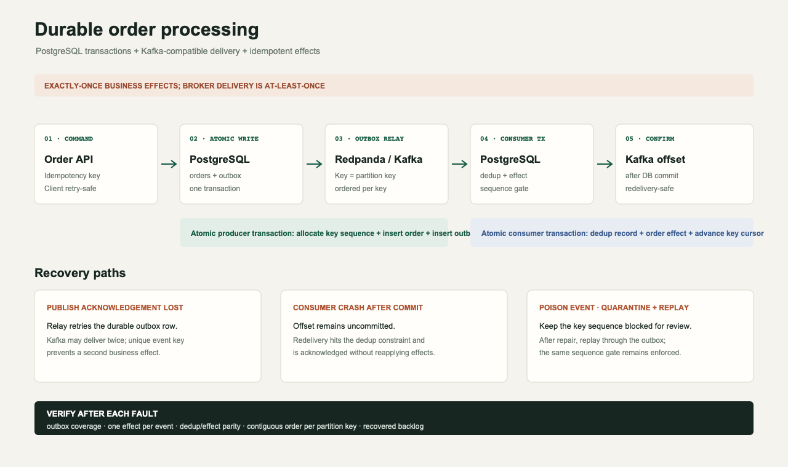

# Exactly-Once Order Processing Pipeline

**Order processing that survives a broker dying mid-publish.**

This project demonstrates that “exactly once” is an application-level outcome, not a broker checkbox. The producer atomically writes an order and its outbox record; the relay may publish repeatedly; the consumer commits its deduplication record and business effect together. Sequence checks preserve order within each partition key.

## Run the system

### Durable local stack: PostgreSQL + Kafka API

The runnable stack uses PostgreSQL for atomic order/outbox and consumer
transactions, Redpanda as a Kafka-compatible broker, and separate API, relay,
and consumer processes:

```bash
docker compose -p order-pipeline -f docker-compose.yml up -d --build
```

The stack exposes the browser lab at <http://localhost:8090> and the order API
at <http://localhost:8080>. PostgreSQL is on `localhost:5432`; Redpanda's Kafka
listener is on `localhost:19092`. This local stack uses development credentials
and is not intended for production deployment.

Submit an order. Retrying the same idempotency key and payload returns the
original order:

```bash
curl -sS -H 'Content-Type: application/json' \
  -d '{"key":"customer-42","idempotencyKey":"checkout-1042","amountCents":2599}' \
  http://localhost:8080/orders

curl -sS http://localhost:8080/health
curl -sS http://localhost:8080/stats
curl -sS http://localhost:8080/dlq
```

List quarantined events and replay one after correcting its payload or
consumer logic:

```bash
go run ./cmd/pipeline dlq
go run ./cmd/pipeline replay-live -event-id evt-<id>
```

The relay publishes the committed outbox rows using the partition key as the
Kafka key. Its single-message transaction deliberately permits a duplicate
publish if the broker acknowledges and the process dies before marking the
outbox row; the consumer's database uniqueness constraints make the business
effect idempotent. The consumer commits the broker offset only after its
PostgreSQL transaction commits.

Run the end-to-end idempotency/processing smoke test, then the 20-run live
fault-injection harness (which kills/restarts the consumer or broker and
disconnects the relay from the Docker network):

```bash
make smoke
make chaos-live
```

Inspect runtime output with `make logs`. Stop containers while retaining local
database/broker volumes with `make stack-down`; add `-v` to `docker compose down`
only when you intentionally want to erase the local data.

### Interactive reliability lab

The browser app also runs by itself with no service dependencies:

```bash
cd /Users/mbiskho/Documents/code/portfolio/software-engineering/exactly-once-order-processing-pipeline
make serve
```

Open <http://localhost:8090>. Submit and retry orders, inject broker and consumer crashes, partition/heal the network, quarantine and replay a message, and run 20 deterministic chaos trials. The browser simulation keeps state in memory. A widescreen flow diagram is
available as [PNG](./reports/durable-system-flow.png) and [editable SVG](./reports/durable-system-flow.svg).

This browser mode is an in-memory simulation. The durable stack above is a
separate runnable implementation; the browser controls do not send requests to
it.

### Executable Go reference model

Go 1.22 or newer is required. The reference model is dependency-free; the
durable runtime uses pgx and kafka-go:

```bash
go test -race ./...
go run ./cmd/pipeline demo
go run ./cmd/pipeline chaos -runs 20 -seed 42
go run ./cmd/pipeline replay
```

- `demo` simulates an accepted publish with a lost broker acknowledgement and a committed consumer transaction with a lost acknowledgement. It prints the final state as JSON.
- `chaos` injects broker-before-accept, broker-after-accept, consumer-before-commit, consumer-after-commit, and network-partition faults. Runs use a seed so results are reproducible.
- `replay` demonstrates dead-letter quarantine, operator replay, and successful processing.
- `serve-api`, `relay`, and `consume` are the service processes used by Docker Compose.
- `submit -key customer-42 -idempotency-key checkout-1042 -amount-cents 2599` sends an order to the durable API's backing PostgreSQL database.
- `dlq` lists active durable dead letters; `replay-live -event-id evt-...` requeues an event through the outbox.

The deterministic reference-model chaos run covers 240 accepted orders across
20 runs, injects 84 modeled faults, suppresses 20 duplicate deliveries, and
checks for zero lost orders, duplicate business effects, or ordering
violations. The live Docker harness separately injects service/network failures
and checks persisted order/effect rows after each run.

## System flow



1. **Accept:** validate an idempotency key and atomically create the order plus outbox event.
2. **Publish:** the outbox relay sends pending events. An ambiguous acknowledgement can cause a duplicate broker delivery; the outbox remains retryable.
3. **Consume:** apply the event only if its sequence is next for that key. Record the dedup key and business effect in one transaction.
4. **Recover:** uncommitted work is redelivered; already-committed work is acknowledged as a duplicate without repeating the effect.
5. **Quarantine/replay:** poison events move to a DLQ; replay returns them to the pending outbox while preserving the key's sequence gate.
6. **Verify:** assert every accepted order has an outbox event, each applied effect is unique, dedup state matches applied effects, and per-key sequences have no gaps or reordering.

## Invariants and fault boundaries

| Failure point | Durable/visible state | Recovery |
|---|---|---|
| Producer fails before transaction commit | Neither order nor outbox event exists | Client retries with same idempotency key |
| Broker fails before accepting publish | Outbox event remains pending | Relay retries |
| Broker accepts publish but acknowledgement is lost | Event can be delivered twice | Consumer deduplication suppresses repeated effect |
| Consumer fails before its transaction commits | Neither dedup row nor business effect commits | Broker redelivers |
| Consumer commits then fails before acknowledgement | Dedup row and effect are durable; delivery remains | Redelivery is acknowledged without reapplying |
| Network partition | Outbox and broker work pause; no event is discarded | Resume relay/consumer after connectivity returns |
| Poison event | Quarantined in DLQ; later sequence for that key remains blocked | Fix payload/handler, replay, then continue that key |

More details: [failure-mode analysis](./reports/failure-modes.md), [chaos-test results](./reports/chaos-test-results.md), and the [PostgreSQL schema/transaction contract](./sql/schema.sql).

## Project scope and deliverables

- Transactional PostgreSQL outbox and ordered Kafka-compatible relay
- Idempotent consumer and per-key ordering guard
- Dead-letter queue with replay command and UI
- Fault-injection harness and invariant checker
- Failure-mode documentation, architecture diagram, and reproducible chaos report

## Runtime boundaries and reproduction

The Docker Compose stack is an executable local integration using PostgreSQL
and Redpanda; it does not require Debezium because the relay polls the
transactional outbox in sequence. It demonstrates process restart and network
partition recovery, but is not a Kubernetes/Chaos Mesh deployment and its
development setup is not production-hardened. The dependency-free Go model and
browser lab remain deterministic teaching tools. `make chaos-live` writes
`reports/chaos-test-results-live.json` only after all 20 live recovery trials
pass. Throughput and recovery-time values from that file describe that local
run, not production capacity.
